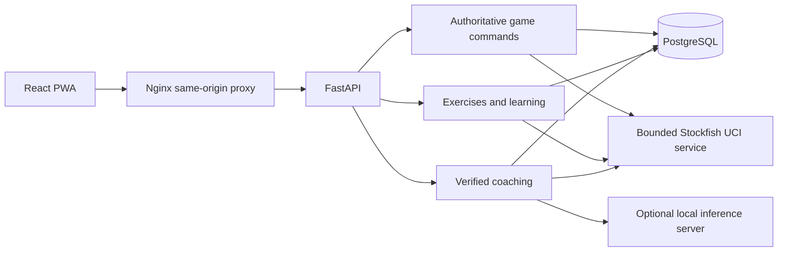

# Architecture

Chessmate has three persistent services: a static React PWA, a FastAPI application that owns chess state, and PostgreSQL. Stockfish is a single managed CPU process inside the backend. An optional OpenAI-compatible inference server can run elsewhere on the private network. A short-lived Compose job applies Alembic migrations before the API starts.

## Module ownership

| Boundary | Implementation | Responsibility |
| --- | --- | --- |
| HTTP and lifecycle | `src/backend/main.py`, `schemas.py`, `views.py`, `config.py` | Validated requests, origin checks, SSE, startup/shutdown, server-owned configuration |
| Profiles | `auth.py` | Profile selection context and profile create, rename, and delete operations |
| Games | `games.py` | Board reconstruction, legal commands, revision checks, immutable action evidence, PGN/FEN, review |
| Engine | `engine.py` | One serialized UCI process, bounded searches/cache, MultiPV, root-perspective grading, practice opponent |
| Chess tools | `chess_tools.py` | Legal move/variation operations and conservative deterministic observations |
| Coaching | `coach.py`, `coach_facts.py` | Position context, fixed learner perspective, bilingual verified statements, model selection validation, fallback |
| Exercises | `exercises.py`, `exercise_library.json` | Original curriculum, objective predicates, localization, explanations |
| Learning | `training.py` | Attempts, hints, repetition, adaptive sessions, recommendations, verified personal exercises and opening practice |
| Persistence | `database.py`, `models.py`, `training_models.py`, `migrations/` | SQLAlchemy tables, indexes, constraints, and versioned schema changes |
| App shell | `src/frontend/src/App.tsx`, `i18n.ts` | Profile selection and management, navigation, shared preferences, language and theme |
| Game interaction | `GameWorkspace.tsx`, `useGameWorkspace.ts`, `Board.tsx`, `exploration.ts` | Board controls, separate variations, stale-result handling, navigation, promotion |
| Coaching UI | `CoachPanel.tsx`, `api.ts` | Position-bound chat, progressive hints, candidate previews, SSE transport |
| Learning UI | `Learn.tsx`, `Repertoire.tsx`, `Pages.tsx` | Lessons, practice, history, observed progress, and settings |
| Installation | `vite.config.ts`, `public/sw.js` | Versioned public-shell precaching; private API responses are excluded |

## State and correctness invariants

1. The backend reconstructs a game from its initial FEN and stored legal move sequence. The browser cannot write a saved FEN directly.
2. Game commands carry an expected revision. PostgreSQL row locks and SQLAlchemy version checks reject competing stale commands instead of overwriting moves.
3. Game actions append audit events. Undo records the removed moves in a new event and creates a new revision.
4. Exploration replays moves on a separate browser board. Analysis endpoints do not mutate games. Commit submits only the variation's first move through the normal legal/revision checks.
5. Engine scores identify the root side to move. White-oriented display values are separate. A player's move is graded from its original position, without using the opponent's later actual reply.
6. The learner's color is independent of the side to move. Coaching while the computer response is paused must keep those perspectives separate.
7. Every analysis and coaching response names its FEN. The browser ignores results for a position it has since left and cancels obsolete chat requests.
8. Candidate and PV references are legal engine outputs. Board geometry is described as geometry unless the relevant tactical continuation is verified.
9. The model selects from verified statements; raw model tactical prose is not displayed. Failure leaves deterministic coaching and chess gameplay available.

## Stored information

Profiles contain preferences and own games, coaching messages, exercise attempts, and learning progress. Legacy password and session columns remain in the database for migration compatibility, but the app no longer offers sign-in or uses them. Profile selection is a local convenience and does not authenticate a person. Games retain move records and their original grading evidence. Coaching messages retain their exact FEN. Exercise attempts and hint events provide an observable learning history; per-exercise scheduling and topic summaries are projections of that history. Opening lines and game-derived exercises belong to their profile. The application does not infer a precise Elo from limited play.

The engine has a bounded memory cache and a database evidence trail. Training seeds are original positions with legal solutions and recorded Stockfish verification. Locally imported content goes through fresh structural, objective, and engine checks before it becomes available.

## Deployment and extension

Only Nginx publishes a port, bound to loopback by default. Backend and database traffic remain inside the Compose network. Inference credentials exist only in backend environment configuration. PostgreSQL storage persists independently of container replacement. SQLite is available for local development and isolated tests.

Future physical-board or voice adapters can use the existing profile-scoped game and coaching boundaries. No such integration or competitive online assistance is implemented. The engine, verified fact catalog, and inference adapter can evolve separately.

See [README.md](README.md) for installation, evaluation thresholds, inference protocol, operational limits, and exact commands; see [IMPLEMENTATION.md](IMPLEMENTATION.md) for actual verification results.
