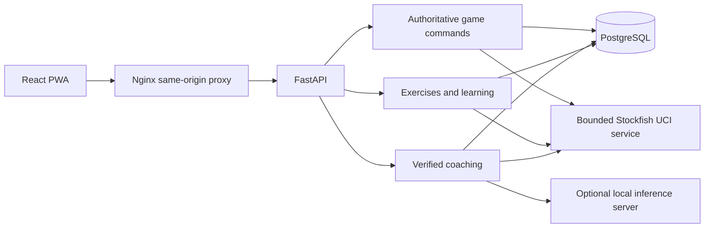
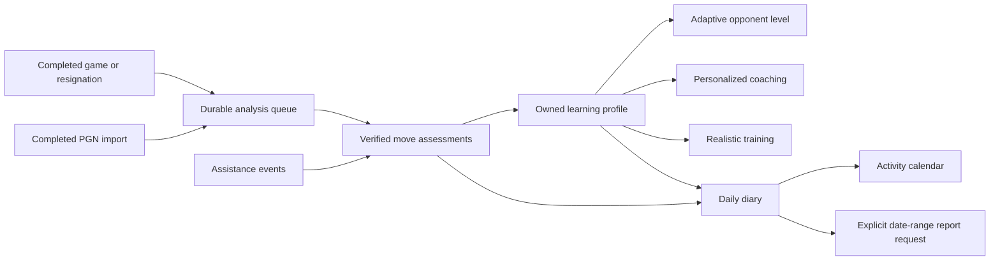

# Architecture

Chessmate has three persistent services: a static React PWA, a FastAPI application that owns chess state, and PostgreSQL. Stockfish has a serialized quick-analysis process and a lazily created, independently serialized deep-analysis process inside the backend. An optional OpenAI-compatible inference server can run elsewhere on the private network. A short-lived Compose job applies Alembic migrations before the API starts.

## Module ownership

| Boundary | Implementation | Responsibility |
| --- | --- | --- |
| HTTP and lifecycle | `src/backend/main.py`, `schemas.py`, `views.py`, `config.py` | Validated requests, origin checks, SSE, startup/shutdown, server-owned configuration |
| Profiles | `auth.py`, `profile_security.py`, `secure_profiles.py` | Trusted local selection or optional password/session authentication, account ownership and lifecycle |
| Games | `games.py` | Board reconstruction, legal commands, revision checks, immutable action evidence, PGN/FEN, review |
| Engine | `engine.py` | Independent serialized quick/deep UCI processes, bounded searches/cache, MultiPV, root-perspective grading, practice opponent |
| Chess tools | `chess_tools.py` | Legal move/variation operations and conservative deterministic observations |
| Coaching | `coach.py`, `coach_facts.py`, `coaching_state.py`, `coaching_persistence.py`, `coaching_language.py`, `coaching_strategy.py` | Position context, fixed learner perspective, bilingual evidence composition, controlled paraphrase, persistent discovery state and visual provenance, strategy, model validation and fallback |
| Calculation | `calculation.py`, `learning_models.py` | Every-ply grading, first-error/final-position checks, immutable practice evidence and replayable history without game mutations |
| Background analysis | `analysis_jobs.py`, `fullgame_analysis.py` | Owned jobs, bounded queue, real UCI cancellation, critical deep checks and atomic revision-checked whole-game results |
| Exercises | `exercises.py`, `exercise_library.json` | Original curriculum, objective predicates, localization, explanations |
| Learning | `training.py`, `training_progress.py`, `training_attempts.py`, `training_generation.py`, `learning_evidence.py` | Attempts, independent-solution evidence, current-step hints, repetition, topic mastery, adaptive sessions, verified personal exercises and opening practice |
| Persistence | `database.py`, `models.py`, `training_models.py`, `coaching_models.py`, `learning_models.py`, `migrations/` | SQLAlchemy tables, indexes, constraints, and versioned schema changes |
| App shell | `src/frontend/src/App.tsx`, `i18n.ts` | Profile selection and management, navigation, shared preferences, language and theme |
| Game interaction | `GameWorkspace.tsx`, `useGameWorkspace.ts`, `Board.tsx`, `exploration.ts` | Board controls, separate variations, stale-result handling, navigation, promotion |
| Coaching UI | `CoachPanel.tsx`, `api.ts` | Position-bound chat, progressive hints, candidate previews, SSE transport |
| Visual teaching | `VariationPlayer.tsx`, `VisualExplanation.tsx`, `CandidateList.tsx` | Shared playback transport, FEN-bound arrows and targets, one-candidate-at-a-time preview, feedback/chat/review demonstrations |
| Learning UI | `Learn.tsx`, `Repertoire.tsx`, `Pages.tsx` | Lessons, practice, history, observed progress, and settings |
| Installation | `vite.config.ts`, `public/sw.js` | Versioned public-shell precaching; private API responses are excluded |

## State and correctness invariants

1. The backend reconstructs a game from its initial FEN and stored legal move sequence. The browser cannot write a saved FEN directly.
2. Game commands carry an expected revision. PostgreSQL row locks and SQLAlchemy version checks reject competing stale commands instead of overwriting moves.
3. Game actions append audit events. Undo records the removed moves in a new event and creates a new revision.
4. Exploration replays moves on a separate browser board. Analysis endpoints do not mutate games. Commit submits only the variation's first move through the normal legal/revision checks.
5. Engine scores identify the root side to move. White-oriented display values are separate. A player's move is graded from its original position, without using the opponent's later actual reply.
6. The learner's color is independent of the side to move. Coaching while the computer response is paused must keep those perspectives separate.
7. Every analysis and coaching response names its FEN. The browser ignores results for a position it has since left and cancels obsolete chat requests.
8. Candidate and PV references are legal engine outputs. Board geometry is described as geometry unless the relevant tactical continuation is verified.
9. The model composes evidence-reference segments from dynamically derived statements. Unchecked prose never enters the rendered answer. Supported segments can survive discarded extra prose or unsupported paraphrases, with a corrected source label; invented evidence or moves still fail validation. Candidate, variation, and disclosure boundaries are checked independently. Failure leaves deterministic coaching and chess gameplay available.
10. Structured insights name their evidence, claim type, squares/arrows, and exact FEN. Variations name their base, legal UCI sequence, and resulting FEN. The UI only shows an annotation on its matching position.
11. Preview playback and calculation use independent boards. Preview-only variations cannot be committed; normal exploration retains its explicitly requested commit flow.

Full-game analysis processes both sides in a bounded background job, deep-verifies critical decisions with the configured 5–20-second search budget, and commits a revision-checked result atomically. Cancellation sends UCI stop and discards uncommitted assessments; a 15-minute work window can return a resumable partial result. It appends an analysis event and replaces assessment evidence without changing move order or game position. Significant move-grading losses receive a larger same-root recheck; conflicting searches produce uncertainty. Explicit deep position analysis uses the separate worker so an extended search does not hold the gameplay engine.

Teaching quality is measured separately from protocol correctness. The frozen 40-position benchmark contains three expected teaching levels, source provenance, legal demonstrations, and unacceptable claims. Captured reports preserve engine budgets and actual provider/fallback sources. Missing human reviews cannot pass the teaching-quality gate.

## Stored information

Profiles own games, coaching messages, exercises and learning records. Trusted local selection is the default. Optional `SECURE_DEPLOYMENT` uses existing password/session tables: salted PBKDF2 hashes, opaque cookie tokens whose digests alone are stored, expiration, throttling, rotation and revocation. The cookie determines identity; a profile header cannot switch accounts.

Migration `28e4cdfddcb2` adds `coaching_states` (optimistic versioned discovery), `coaching_evidence` (the exact validated response/visual payload), and append-only `learning_events` (calculation attempts). Legacy games and preferences remain compatible. Calculation history and per-topic mastery project these observations; seven granular skills are reported only when supported. Learning transfer joins earlier completed practice to subsequent actual player move events with matching position or verified motif, excludes imports/analysis/opponent moves, and reports association rather than causal improvement. Opening lines and game-derived exercises stay private to their profile.

The engine has a bounded memory cache and a database evidence trail. Training seeds are original positions with legal solutions and recorded Stockfish verification. Locally imported content goes through fresh structural, objective, and engine checks before it becomes available.

## Deployment and extension

Only Nginx publishes a port, bound to loopback by default. Backend and database traffic remain inside the Compose network. Inference credentials stay in backend environment configuration or profile-owned connection records; API responses expose only whether a key exists. PostgreSQL storage persists independently of container replacement. SQLite is available for local development and isolated tests.

Future physical-board or voice adapters can use the existing profile-scoped game and coaching boundaries. No such integration or competitive online assistance is implemented. The engine, verified fact catalog, and inference adapter can evolve separately.

See [README.md](README.md) for installation, evaluation thresholds, inference protocol, operational limits, and exact commands; see [IMPLEMENTATION.md](IMPLEMENTATION.md) for actual verification results.

## Automatic personalized learning

Completed non-analysis games write a durable `game_learning_analyses` outbox record in the same game-command transaction. One bounded background worker claims records using a lease and atomic database update. It reuses trustworthy move assessments, evaluates missing decisions, deep-checks critical positions, checkpoints longer work, and saves versioned observations. Failed work has bounded retries and backoff; expired leases can be reclaimed after restart. A deterministic observation identifier prevents duplicate learning events when the same game is processed again. Interactive play retains the existing quick engine and separate deep engine.

`assistance.py` appends disclosure events for general guidance, piece reveals, destination reveals, complete solutions and engine exploration. Game decisions retain their assistance classification and source. Undo preserves earlier disclosures; imported or old records without reliable metadata remain unknown. Training, imported games and actual game decisions stay distinguishable. The existing hint, candidate, coaching, visual and exploration flows feed these records.

`automatic_learning.py` projects the latest 120 completed analyses into an owned `player_learning_states` snapshot. Concept conclusions require distinct games and observed opportunities. Recency weighting and separate independent counts qualify trends. Adaptive difficulty uses the existing five-level opponent scale, requires four eligible games and at least 32 independent decisions for a possible one-level change, and consumes each evidence window once. Those levels are not calibrated Elo estimates.

`adaptive_diary.py` projects completed games into one `daily_diaries` row per profile and local date, protected by a unique key and transactional updates. Completion time in the configured IANA timezone determines the date; explicit resignation and declared PGN results retain their provenance and also complete the lifecycle; pending, failed and partial analysis stay visible. Narratives are generated from structured evidence with a deterministic bilingual fallback and are persisted until the underlying fingerprint changes. Rebuilding a diary never replaces immutable game or assistance events.

Reports in `progress_reports` are created only by explicit requests. They aggregate daily structured evidence and deduplicate referenced decisions, retain diary versions and source fingerprints, qualify small comparisons and mark changed underlying records as outdated. Missing diary evidence remains explicit. No weekly or monthly report scheduler is introduced.

`gameplay_training.py` chooses authentic game/exercise positions, prioritizes learning needs and avoids repeatedly serving the same position. It starts an ordinary authoritative game that can continue after any legal decision. Blind mode omits the focus from the visible game context. A focus without an eligible verified realistic position returns an explanatory error instead of mislabeling an unrelated puzzle.

The three additive migrations (`c1ad7e201001`, `c1ad7e201002`, `c1ad7e201003`) preserve historical game data and mark old difficulty and assistance honestly. See [the implementation record](ADAPTIVE_COACHING.md) for acceptance checks, settings, rebuilding and measured verification limits.
